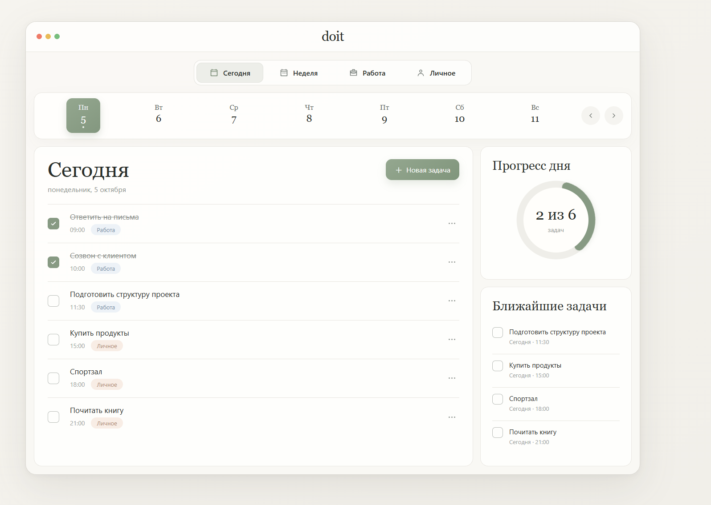
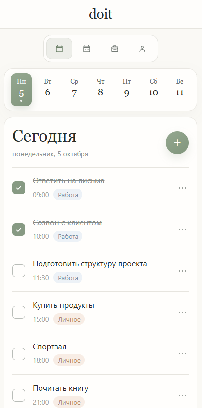

# doit

Минималистичный планировщик задач с фокусом на ежедневные дела и простой организацией времени.

Задачи можно создавать, редактировать, отмечать выполненными и распределять между личными и рабочими делами. Интерфейс намеренно оставлен лёгким и спокойным — только необходимые инструменты без перегруженных меню и лишних элементов.

### [Открыть демо →](https://doit-plum-sigma.vercel.app/)

## Превью

### Desktop



### Mobile



## Возможности

- создание новых задач;
- редактирование и удаление задач;
- отметка выполненных дел;
- планирование задач по времени;
- просмотр задач на выбранный день;
- недельный календарь;
- категории «Работа» и «Личное»;
- фильтры «Сегодня» и «Неделя»;
- список ближайших задач;
- прогресс выполненных дел;
- плавная анимация прогресса;
- сохранение задач между сессиями;
- адаптивный интерфейс для desktop и mobile.

## Стек

- Vue 3
- Vite
- JavaScript
- CSS
- LocalStorage

## Запуск локально

```bash
git clone https://github.com/wakukiku/doit.git
cd doit
npm install
npm run dev
```
